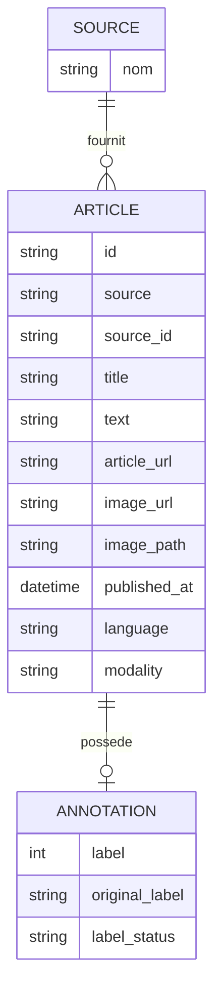

# Schéma conceptuel des données — CheckIt.AI

## 1. Objectif

Ce modèle conceptuel décrit les données multimodales collectées et transformées dans le cadre du projet **CheckIt.AI**.

Il représente les principales entités métier, leurs attributs et leurs relations, indépendamment du système de stockage utilisé.

Le modèle poursuit quatre objectifs :

* Identifier la provenance de chaque observation.
* Structurer les informations textuelles, visuelles et les métadonnées associées.
* Préserver le lien entre un contenu textuel et son éventuelle image.
* Distinguer les observations annotées, faiblement supervisées et non annotées pour un éventuel usage en intelligence artificielle.

Les données proviennent de trois sources :

* **FakeNewsNet** : jeu de données contenant des observations associées à des labels binaires.
* **Fakeddit** : jeu de données multimodal contenant des textes, des références d'images et des annotations issues d'une supervision faible.
* **NewsData.io** : API d'actualités fournissant des articles et des métadonnées, sans annotation de véracité.

Après extraction et transformation, ces données sont harmonisées dans un schéma commun de **14 colonnes**.

---

## 2. Diagramme conceptuel des données

Le diagramme suivant présente trois entités métier : `SOURCE`, `ARTICLE` et `ANNOTATION`.

Il s'agit d'une représentation conceptuelle des données, et non d'un schéma physique de base de données.



**Remarque :** les trois entités sont représentées séparément pour faciliter la compréhension du domaine métier. Dans l'implémentation actuelle, leurs attributs sont regroupés dans un fichier CSV unifié.

---

## 3. Description des entités

### 3.1. SOURCE

L'entité `SOURCE` représente la provenance des observations collectées.

**Attribut :**

| Attribut | Type                 | Description                                              |
| -------- | -------------------- | -------------------------------------------------------- |
| `nom`    | Chaîne de caractères | Nom de la source : FakeNewsNet, Fakeddit ou NewsData.io. |

**Règles métier :**

* Une source peut fournir plusieurs observations.
* Chaque observation provient d'une seule source.
* La provenance doit être conservée après les transformations et la fusion des données.

Dans le fichier final, cette information est représentée par la colonne `source`.

### 3.2. ARTICLE

L'entité `ARTICLE` représente une observation issue de l'une des sources étudiées.

Le terme *article* est utilisé ici au sens large : il peut désigner un article d'actualité, une publication ou une observation textuelle provenant d'un jeu de données.

**Attributs :**

| Attribut       | Type                 | Description                                                                        |
| -------------- | -------------------- | ---------------------------------------------------------------------------------- |
| `id`           | Chaîne de caractères | Identifiant unique généré pour l'observation dans le pipeline.                     |
| `source`       | Chaîne de caractères | Nom de la source d'origine.                                                        |
| `source_id`    | Chaîne de caractères | Identifiant original de l'observation dans sa source.                              |
| `title`        | Chaîne de caractères | Titre ou contenu textuel court.                                                    |
| `text`         | Chaîne de caractères | Texte ou description disponible.                                                   |
| `article_url`  | Chaîne de caractères | URL de la publication ou de l'article d'origine, lorsqu'elle existe.               |
| `image_url`    | Chaîne de caractères | URL de l'image associée, lorsqu'elle est disponible.                               |
| `image_path`   | Chaîne de caractères | Chemin local de l'image, lorsqu'elle a été téléchargée.                            |
| `published_at` | Date et heure        | Date de publication, lorsqu'elle est disponible.                                   |
| `language`     | Chaîne de caractères | Langue du contenu, lorsqu'elle est connue.                                         |
| `modality`     | Chaîne de caractères | Modalité de l'observation, par exemple texte seul ou texte accompagné d'une image. |

**Règles métier :**

* Chaque observation possède un identifiant `id` unique.
* Chaque observation est rattachée à une source.
* Une observation peut contenir du texte et une référence vers une image.
* L'absence d'image est autorisée.
* Certaines métadonnées peuvent être absentes selon la source.
* L'identifiant `source_id` conserve la référence originale de l'observation et ne doit pas être confondu avec le nom de la source.

### 3.3. ANNOTATION

L'entité `ANNOTATION` représente les informations de classification éventuellement associées à une observation.

**Attributs :**

| Attribut         | Type                          | Description                                                                   |
| ---------------- | ----------------------------- | ----------------------------------------------------------------------------- |
| `label`          | Entier nullable               | Label binaire normalisé lorsqu'il est disponible : `0` ou `1`.                |
| `original_label` | Chaîne de caractères nullable | Valeur ou catégorie d'annotation provenant de la source initiale.             |
| `label_status`   | Chaîne de caractères          | Statut permettant de qualifier la disponibilité et la nature de l'annotation. |

**Règles métier :**

* Une observation peut ne posséder aucune annotation.
* Lorsqu'un label binaire est disponible, il est conservé dans `label`.
* Le champ `original_label` permet de préserver l'information initiale.
* Le champ `label_status` permet de distinguer les différentes situations d'annotation.

Les statuts utilisés dans notre pipeline sont :

| Statut             | Signification                                              |
| ------------------ | ---------------------------------------------------------- |
| `binary`           | Une annotation binaire est disponible.                     |
| `weak_supervision` | L'annotation provient d'une méthode de supervision faible. |
| `unlabeled`        | Aucune annotation exploitable n'est disponible.            |

**Précaution importante :**

Les valeurs `0` et `1` ne doivent pas être interprétées indépendamment de leur source et de leur protocole d'annotation.

Dans FakeNewsNet, elles correspondent à notre mapping des catégories *real* et *fake*.

Dans Fakeddit, les annotations sont issues d'un autre protocole et ne constituent pas nécessairement des verdicts de véracité journalistique.

Les observations provenant de NewsData.io ne possèdent pas de label de véracité.

Il serait donc incorrect de considérer automatiquement l'ensemble des observations comme un jeu d'entraînement supervisé homogène.

---

## 4. Description des relations

### 4.1. Relation SOURCE — ARTICLE

**Relation :** une source fournit des observations.

**Cardinalités :**

* Une source peut fournir zéro à plusieurs observations.
* Chaque observation est associée à exactement une source.

Cette relation permet de conserver la provenance des données après leur harmonisation.

Elle facilite également les analyses par source et les contrôles de qualité.

### 4.2. Relation ARTICLE — ANNOTATION

**Relation :** une observation peut posséder une annotation.

**Cardinalités :**

* Une observation peut posséder zéro ou une annotation dans le modèle actuel.
* Une annotation est associée à une seule observation.

Cette relation permet de représenter les observations annotées et non annotées sans imposer la présence d'un label pour chaque article.

Dans le fichier CSV unifié, les champs d'annotation sont intégrés à chaque ligne. Les valeurs manquantes sont autorisées lorsque l'observation n'est pas annotée.

---

## 5. Association texte-image

L'association entre les données textuelles et visuelles constitue une exigence importante du projet.

Dans notre modèle, les champs suivants appartiennent à une même observation :

* `id` : identifiant unique de l'observation ;
* `title` : titre ou contenu textuel court ;
* `text` : texte ou description ;
* `image_url` : référence de l'image distante ;
* `image_path` : emplacement local éventuel de l'image.

Le rattachement de ces attributs à une même observation permet de **préserver le lien structurel entre le texte et l'image**.

Une observation peut être :

* Textuelle uniquement.
* Textuelle avec une référence d'image.
* Textuelle avec une image téléchargée localement, lorsque cette étape a été réalisée.

L'absence d'image est autorisée.

**Point de vigilance :** l'existence d'une URL d'image ne garantit pas que le fichier est accessible, valide ou pertinent par rapport au texte.

La validation effective des images nécessite des contrôles complémentaires, notamment lors de leur téléchargement et de leur traitement.

---

## 6. Correspondance avec le schéma commun du pipeline

Les transformations réalisées sur FakeNewsNet, Fakeddit et NewsData.io produisent des données respectant un schéma commun de **14 colonnes**.

Ces colonnes sont ensuite regroupées dans le fichier :

`data/processed/articles_unified.csv`

La correspondance entre les entités conceptuelles et les colonnes du fichier est la suivante :

| Entité conceptuelle | Colonnes du fichier unifié                                                                                           |
| ------------------- | -------------------------------------------------------------------------------------------------------------------- |
| SOURCE              | `source`                                                                                                             |
| ARTICLE             | `id`, `source_id`, `title`, `text`, `image_url`, `image_path`, `article_url`, `published_at`, `language`, `modality` |
| ANNOTATION          | `label`, `original_label`, `label_status`                                                                            |

Le fichier unifié contient donc les 14 colonnes suivantes :

```text
id
source
source_id
title
text
image_url
image_path
article_url
published_at
language
label
original_label
label_status
modality
```

**Distinction importante :**

Le modèle conceptuel présente les informations sous forme d'entités métier et de relations.

Le fichier CSV constitue une représentation tabulaire de ces informations.

Le modèle conceptuel n'implique pas que les données soient actuellement stockées dans trois tables SQL distinctes.

---

## 7. Contrôles de qualité et contraintes d'intégrité

Le pipeline de transformation et de fusion applique plusieurs contrôles de qualité.

### 7.1. Structure des données

Les données issues des différentes sources sont harmonisées selon un schéma commun.

Les colonnes attendues sont vérifiées afin de garantir la cohérence des fichiers produits.

### 7.2. Unicité des identifiants

Chaque observation possède un identifiant `id` unique.

Les tests de transformation et de fusion vérifient l'absence de doublons sur cet identifiant.

### 7.3. Conservation de la provenance

Les informations `source` et `source_id` permettent de retrouver l'origine des observations.

Cette traçabilité est essentielle pour interpréter correctement les données et leurs annotations.

### 7.4. Gestion des valeurs manquantes

Certaines informations peuvent être absentes selon la source.

Les valeurs manquantes sont conservées lorsque leur absence est légitime, notamment pour :

* Les images.
* Les dates de publication.
* Certaines descriptions.
* Les annotations de véracité.

L'absence d'une annotation ne doit pas conduire à l'attribution artificielle d'un label.

### 7.5. Conservation des annotations

Les annotations sont harmonisées tout en préservant leur provenance et leur nature.

La distinction entre `binary`, `weak_supervision` et `unlabeled` permet d'éviter une interprétation incorrecte des labels.

### 7.6. Tests automatisés

Les tests automatisés réalisés sur les transformations et la fusion vérifient notamment :

* La conformité du schéma commun.
* La présence des colonnes obligatoires.
* L'unicité des identifiants.
* La conservation de la provenance.
* La cohérence des annotations.
* La détection des doublons.
* La conservation des observations lors de la fusion.

Lors de la dernière exécution, **29 tests de transformation ont été validés**.

Ces résultats confirment le bon fonctionnement des contrôles testés. Ils ne garantissent toutefois pas, à eux seuls, la validité sémantique de tous les contenus ou de toutes les images.

---

## 8. Utilisation pour l'intelligence artificielle

Le modèle de données est conçu pour permettre une exploitation ultérieure dans des traitements d'intelligence artificielle.

### 8.1. Traitement automatique du langage naturel

Les champs `title` et `text` peuvent être utilisés pour des tâches de traitement automatique du langage naturel (NLP).

Ils peuvent notamment servir à :

* Préparer un corpus textuel.
* Réaliser des analyses linguistiques.
* Construire des représentations vectorielles.
* Alimenter ultérieurement un modèle de classification.

### 8.2. Traitement multimodal

Les champs `image_url` et `image_path` permettent d'identifier les ressources visuelles associées aux observations.

Ils constituent une base pour une éventuelle exploitation conjointe du texte et des images.

Une utilisation multimodale effective nécessitera toutefois de vérifier la disponibilité et la validité des fichiers image.

### 8.3. Classification supervisée

Les champs `label`, `original_label` et `label_status` permettent de sélectionner les observations adaptées à une éventuelle tâche de classification.

Il est essentiel de tenir compte :

* De la provenance des observations.
* Du protocole d'annotation.
* De la signification des classes.
* Du niveau de fiabilité des labels.

Les observations non annotées restent exploitables pour d'autres analyses, mais ne doivent pas être considérées comme des exemples supervisés.

### 8.4. Limites pour un futur modèle de détection de fausses informations

Les sources retenues ne fournissent pas toutes le même niveau d'information ni les mêmes garanties concernant les annotations.

En particulier :

* FakeNewsNet fournit des labels binaires, mais les contenus complets et les ressources associées ne sont pas toujours accessibles.
* Fakeddit fournit des données multimodales et des annotations issues d'une supervision faible, dont la signification diffère de celle des labels journalistiques.
* NewsData.io fournit des actualités récentes, mais ne fournit pas de verdicts de véracité.

Une éventuelle phase de modélisation devra donc définir précisément les données admissibles et la signification de la variable cible.

**L'entraînement d'un modèle de détection de fausses informations ne fait pas partie du périmètre de cette étape du projet.**

---

## 9. Conclusion

Le schéma conceptuel proposé structure les données du projet CheckIt.AI autour de trois entités métier : **SOURCE**, **ARTICLE** et **ANNOTATION**.

Il permet :

* De conserver la provenance de chaque observation.
* De représenter les contenus textuels et les références d'images.
* De préserver l'association entre texte et image.
* De distinguer les différents statuts d'annotation.
* De faciliter une exploitation ultérieure des données pour l'intelligence artificielle.

Ce modèle est cohérent avec le schéma commun de 14 colonnes utilisé dans les scripts Python de transformation et de fusion.

Il constitue une représentation conceptuelle des données, indépendante du choix d'un futur système de stockage.

La définition d'un éventuel schéma physique de base de données pourra intervenir lors de l'étape de chargement et de stockage des données.
